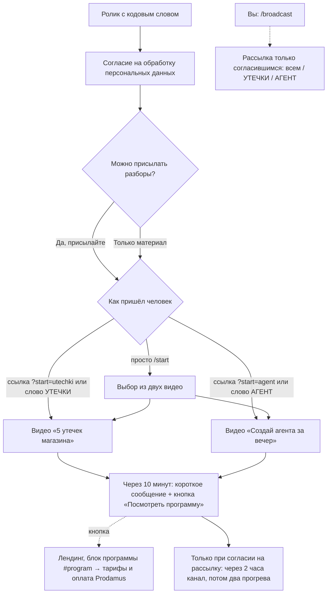

# Бот Елены Тимошенко: лид-магниты, программа курса и прогрев

Бот выдаёт видео по кодовому слову из роликов. Сначала он просит согласие на обработку персональных данных и отдельно — на рассылку. Через 10 минут присылает короткое сообщение с кнопкой «Посмотреть программу» курса «Прибыльный ИИ-отдел для селлера» на лендинге. Через 2 часа он приглашает в ваш Telegram-канал, потом присылает два тёплых сообщения — но только тем, кто согласился на рассылку. Ещё вы можете сами делать рассылку по этой же базе.

Оплаты в боте нет: курс оплачивается только на лендинге через Prodamus. Бот не знает, кто оплатил. Сообщение с программой получает каждый, кто взял видео и не остановил бота. Приглашение в канал, прогрев и рассылка уходят только тем, у кого согласие на рассылку включено.

**Что где лежит**

| Файл | Зачем |
|---|---|
| `texts.yaml` | **Все тексты и кнопки.** Правите только его |
| `Тексты бота.md` | Все сообщения по порядку, чтобы прочитать сценарий целиком |
| `.env.example` | Список настроек: токен, ссылки, задержки. На Bothost они вводятся в панели |
| `main.py` | Главный файл Telegram-бота, его запускает хостинг |
| `main_max.py` | Главный файл бота MAX. На Bothost указывается отдельно, Telegram-бота не заменяет |
| `bot.py`, `max_bot.py`, `max_api.py`, `funnel.py`, `logic.py`, `broadcast.py`, `db.py`, `config.py`, `texts.py` | Код. Тексты общие: `texts.yaml` |
| `bothost.json` | Подсказка для Bothost: главный файл и версия Python |
| `requirements.txt` | Библиотеки, хостинг ставит их сам |
| `run.sh`, `Dockerfile` | Запасные способы запуска: свой сервер или этот компьютер. Для Bothost не нужны |
| `tests/` | Проверки логики без Telegram |
| `bot_bothost.zip` | Готовый архив для загрузки на Bothost |

## Как работает воронка



- Перед видео бот показывает два шага. Первый обязательный: согласие на обработку персональных данных (ссылки на политику и текст согласия, кнопка «Согласна(сен) на обработку персональных данных»). Пока кнопку не нажали, любое другое сообщение или команда снова показывает этот шаг. Второй: «Да, присылайте» или «Только материал». Видео уходит после любой из этих кнопок. Ссылка `?start=utechki` или `?start=agent` не теряется: бот запоминает её и выдаёт нужное видео после согласий.
- Время каждого согласия пишется в базу (`pd_consent_at`, `mailing_consent_at`, unix UTC) и в журнал событий. Это подтверждение, когда человек нажал кнопку.
- Кто уже был в базе и согласия ещё не давал, при следующем сообщении тоже видит первый шаг. Пока он не нажал «Да, присылайте», прогрев и рассылка ему не уходят.
- `/stop` выключает рассылку и отвечает: «Вы отписались от рассылки. Материалы и бот остаются доступны.» Ответы на действия человека (видео, согласие, программа курса) рассылкой не считаются.
- Бот запоминает, с какого слова пришёл человек. Это видно в `/stats`, а ссылка на лендинг получает метку `?src=utechki` или `?src=agent`, чтобы вы видели источник в аналитике сайта.
- Ночью бот не пишет. Если время сообщения выпало на ночь, оно уйдёт в 10:00 по Москве (`SEND_FROM_HOUR`, `SEND_TO_HOUR`, `TIMEZONE`). Исключение: сообщение с программой через 10 минут после видео уходит точно через 10 минут, даже ночью — человек в этот момент ещё у бота. Приглашение в канал и прогрев сдвигаются на утро, только если сами попали на ночь (например, видео взяли в 20:00 — приглашение через 2 часа уйдёт утром).
- Задержки настраиваются: `PROGRAM_DELAY_MINUTES` (10, 0 = отправить сразу после видео), `CHANNEL_INVITE_DELAY_HOURS` (2), `WARMUP1_DELAY_HOURS` (24), `WARMUP2_DELAY_HOURS` (60). Сообщения идут в порядке задержек. Для программы 0 значит «сразу», для остальных шагов 0 выключает сообщение. В Bothost новую переменную добавлять не нужно: если её нет, бот берёт 10 минут.
- Очередь сообщений хранится в базе, поэтому после перезапуска ничего не теряется.
- Кто остановил бота в Telegram, тому бот больше ничего не шлёт. Если человек вернётся и нажмёт «Старт», он снова в базе. `/stop` — это другое: рассылка выключается, а бот и материалы остаются.
- Нажатия на «Посмотреть программу» бот не считает: это прямая ссылка на сайт, Telegram не сообщает боту о переходе. Переходы смотрите в аналитике сайта по метке `src`. Так честнее и проще, чем гонять человека через лишнюю кнопку.

**Ваши команды** (работают только с вашего аккаунта, указанного в `ADMIN_ID`):
- `/broadcast` запускает рассылку по базе, подробности ниже;
- `/cancel` отменяет рассылку, пока вы не нажали «Отправить»;
- `/stats` показывает, сколько людей пришло по каждому слову, сколько получили каждое отложенное сообщение, сколько остановили бота и сколько было рассылок;
- `/myid` показывает ваш chat id (эта команда работает у всех);
- `/stop` отписывает от рассылки (эта команда тоже работает у всех);
- если прислать боту видео, он ответит его `file_id`, и видео можно отдавать прямо в Telegram, а не ссылкой.

## Рассылка по базе

1. Напишите боту `/broadcast`.
2. Пришлите сообщение: текст, фото с подписью или видео с подписью. Жирный, курсив и ссылки сохранятся. Если нужна кнопка-ссылка, добавьте **последней строкой**:
   ```
   Кнопка: Текст на кнопке | https://ссылка
   ```
   Например: `Кнопка: Посмотреть программу | https://ваш-сайт.ru/#program`. Кнопка может быть только одна.
3. Бот покажет сообщение так, как его увидят люди, и под ним выбор: **Всем**, **УТЕЧКИ** (кто брал видео «5 утечек магазина») или **АГЕНТ** (кто брал «Агента за вечер»). Рядом число получателей. Человек, взявший оба видео, есть в обоих списках.
4. Нажмите «✅ Отправить» или «✖️ Отмена». После отправки бот работает в фоне: по 15 сообщений в секунду (`BROADCAST_RATE_PER_SEC`, больше 20 бот не поставит), а людям при этом отвечает как обычно. В конце пришлёт итог: сколько доставлено, сколько не доставлено из-за ошибки, сколько человек остановили бота.

Что важно:
- рассылка уходит только тем, кто нажал «Да, присылайте» и не остановил бота. Старые контакты без этого согласия в рассылку не попадают;
- если Telegram просит подождать (flood control), бот ждёт и пробует ещё раз, до 3 попыток на человека;
- кто остановил бота, помечается и больше не получает ни рассылки, ни прогрев;
- одновременно идёт только одна рассылка;
- каждая рассылка записывается в базу, их число и итог последней видны в `/stats`;
- подпись к фото или видео — до 1024 знаков, текст — до 4096 (ограничение Telegram).

---

## Шаг 1. Создать бота в @BotFather и получить токен

1. Откройте в Telegram [@BotFather](https://t.me/BotFather) и нажмите «Start».
2. Отправьте `/newbot`.
3. Напишите имя бота, его видят люди, например «Елена Тимошенко · ИИ для селлеров».
4. Напишите адрес бота латиницей, в конце обязательно `bot`, например `elena_ai_seller_bot`.
5. BotFather пришлёт **токен**, длинную строку вида `1234567890:AAH...`. Это пароль от бота: никому не пересылайте и не публикуйте.
6. По желанию: `/setuserpic` поставит аватар, `/setdescription` задаст текст, который человек видит до нажатия «Start».

Ссылки для роликов будут такими (вместо `elena_ai_seller_bot` подставьте адрес вашего бота):
- `https://t.me/elena_ai_seller_bot?start=utechki` ведёт к «5 утечкам магазина»;
- `https://t.me/elena_ai_seller_bot?start=agent` ведёт к «Агенту за вечер».

Ещё человек может просто открыть бота и написать слово: утечки, Утечки, УТЕЧКИ — бот поймёт любой вариант.

## Шаг 2. Узнать свой chat id (ADMIN_ID)

После запуска бота (шаг 4) напишите ему `/myid`. Он ответит числом. Это число впишите в `ADMIN_ID` и перезапустите бота. Пока `ADMIN_ID` пустой, `/stats` и `/broadcast` не работают, а остальное уже работает.

## Шаг 3. Настройки

Все настройки описаны в `.env.example`, с пояснением у каждой строки. Обязательные: `BOT_TOKEN`, `ADMIN_ID`, ссылки на два видео и `LANDING_URL` (адрес лендинга, кнопка сама добавит `#program`). Для приглашения в канал нужен `CHANNEL_URL`.

Пустая строка значит, что функция выключена. Например, без `CHANNEL_URL` приглашение в канал не отправляется, а без `LANDING_URL` под сообщениями не будет кнопки программы.

---

## Шаг 4. Запуск на Bothost

Этот порядок взят из документации Bothost (проверено 18.11.2026): [загрузка из архива](https://bothost.ru/docs/upload-bot-archive), [переменные окружения](https://bothost.ru/docs/environment-variables), [хранение базы](https://bothost.ru/docs/sqlite-data-lost), [FAQ](https://bothost.ru/docs/faq). Шаги, которые я не смогла проверить по документации, помечены ⚠️.

**Какой тариф нужен.** По документации Bothost, на бесплатном тарифе:
- нет переменных окружения;
- загрузка из архива недоступна;
- данные стираются при перезапуске.

Боту нужны все три вещи: настройки, архив и база с очередью прогрева. Поэтому нужен тариф **«Базовый»** или выше. Цену смотрите на bothost.ru.

1. Зарегистрируйтесь на [bothost.ru](https://bothost.ru) и подключите тариф «Базовый».
2. Откройте **профиль** и в блоке **«Интерфейс»** включите **«Загрузка бота из архива»**. Сохраните.
3. На странице **«Мои боты»** появится фиолетовая кнопка **«Загрузить из архива»**. Нажмите её. Откроется мастер из трёх шагов: Архив → Настройка → Деплой.
4. **Архив.** Перетащите файл `bot_bothost.zip` и нажмите «Далее».
5. **Настройка.** Заполните поля:
   - **Название**: любое;
   - **Токен бота**: токен из @BotFather;
   - **Язык / шаблон**: можно оставить «Авто» или выбрать aiogram;
   - **Главный файл**: `main.py`. Можно оставить пустым: архив содержит `bothost.json`, где это уже указано.
6. **Деплой.** Нажмите «Задеплоить» и не закрывайте страницу, пока архив загружается. В логе сборки видно, как ставятся библиотеки.
7. **Переменные окружения.** Откройте настройки бота, затем раздел «Переменные окружения». Добавьте по одной строки из `.env.example`: ключ, например `ADMIN_ID`, и значение. `BOT_TOKEN` добавлять не нужно, Bothost передаёт его сам из поля «Токен бота». После изменения переменных **перезапустите бота**.
   - ⚠️ В документации сказано «перезапустите», но не уточняется, хватит ли кнопки рестарта. Если бот не видит новую настройку, сделайте повторный деплой: загрузите тот же архив кнопкой обновления на карточке бота.
8. Откройте **«Логи работы»**. Если всё хорошо, там будет строка `Бот @имя запущен` и две готовые ссылки для роликов.
9. Напишите боту `/myid`, впишите число в переменную `ADMIN_ID` и перезапустите бота. Проверьте `/stats`.
10. Пройдите воронку сами: откройте ссылку `?start=utechki`. Сначала бот просит согласие на персональные данные, затем спрашивает про рассылку. После любой из кнопок («Да, присылайте» или «Только материал») приходит видео. Подождите 10 минут (или временно поставьте `PROGRAM_DELAY_MINUTES=1`), нажмите «Посмотреть программу» и проверьте, что открылся блок программы на лендинге. Приглашение в канал и прогрев придут только после «Да, присылайте». Для проверки задержек можно временно поставить `CHANNEL_INVITE_DELAY_HOURS=0.05` (3 минуты), потом вернуть 2. `/stop` должен ответить, что рассылка отключена.
11. Проверьте рассылку на себе: `/broadcast`, короткий текст, фильтр, «Отмена».

**Где хранится база.** Bothost сохраняет между обновлениями только папку `/app/data` (переменная `DATA_DIR`). Бот сам кладёт туда свою базу `bot.sqlite3`, ничего настраивать не нужно. При загрузке нового архива токен, переменные и данные в `/app/data` сохраняются, пересобирается только код.
- ⚠️ Если в «Логах работы» видно, что база создалась не в `/app/data`, добавьте переменную `DB_PATH=/app/data/bot.sqlite3`.

**Как обновить тексты или код.** Поправьте `texts.yaml` и соберите архив заново (или попросите меня). Затем на карточке бота нажмите кнопку загрузки нового архива (иконка файла).

**Важно: один токен — один запущенный бот.** Не запускайте этого же бота параллельно на компьютере или другом сервере. Иначе в логах появится `Conflict: terminated by other getUpdates request`, и бот будет отвечать через раз.

**Если что-то не так:**
- в «Логах сборки» ошибка `pip`: пришлите мне текст ошибки;
- в «Логах работы» `Не задан BOT_TOKEN`: проверьте поле «Токен бота»;
- `SyntaxError` в самом начале: на Bothost старая версия Python. В `bothost.json` указана 3.11. ⚠️ Какие версии доступны, в документации не написано;
- бот молчит, хотя статус running: смотрите статью Bothost [«Бот не отвечает»](https://bothost.ru/docs/bot-not-responding).

⚠️ В документации есть оговорка: загрузка из архива пока работает на одной тестовой ноде. Если мастер не появляется или загрузка не идёт, второй официальный путь — деплой из репозитория GitHub/GitLab ([быстрый старт](https://bothost.ru/docs/getting-started)). Тогда в репозиторий кладутся те же файлы, что в архиве.

---

## Если захотите вернуть кнопку «Написать Елене»

Сейчас её нет намеренно, а с ней убрано и уведомление вам о нажатии. Вернуть просто: в коде добавляется вторая кнопка-ссылка на ваш личный Telegram (`https://t.me/ваш_ник`, можно с готовым текстом «Здравствуйте, Елена! Я из бота…») и настройка `ELENA_USERNAME`. Если нужно уведомление, кто нажал и с какого видео, кнопка делается через бота, а не прямой ссылкой. Это небольшая правка: попросите меня.

---

## Запасные способы запуска

### На этом компьютере или своём Linux-сервере (`run.sh`)
```bash
cd /workspace/labelles/bot
cp .env.example .env          # и заполните .env
# токен можно не писать в .env, а передать переменной: export BOT_TOKEN=...
nohup ./run.sh > /dev/null 2>&1 &   # запуск в фоне, сам перезапускается при сбое
```
- Работает ли бот: `pgrep -af "main.py"` (должна быть строка с `main.py`) и `tail -n 30 bot.log`.
- Остановить: `pkill -f run.sh; pkill -f main.py`.
- Перезапустить после правки текстов: остановить и запустить снова.
- База лежит в `data/bot.sqlite3`.
- Бот работает, только пока включён компьютер.

### На VPS или в облаке через Docker (Timeweb Cloud, Amvera, Railway и т.п.)
```bash
docker build -t elena-bot .
docker run -d --restart=always --env-file .env -v elena-bot-data:/app/data --name elena-bot elena-bot
docker logs -f elena-bot
```
Главное на любом хостинге:
- база должна лежать на постоянном диске (папка `/app/data`);
- настройки задаются переменными окружения;
- бот работает через long polling, домен и порт не нужны.

---

## Бот в мессенджере MAX

Тот же сценарий, что у Telegram-бота: согласия, видео по `utechki` и `agent`, пауза перед программой, канал, прогрев и рассылка. Тексты берутся из того же `texts.yaml`. Оплаты внутри бота нет. База отдельная (`max_bot.sqlite3`), потому что числовые id в MAX и Telegram разные и их нельзя складывать в одну таблицу.

Ссылки на видео:

- `https://max.ru/<ник_бота>?start=utechki`
- `https://max.ru/<ник_бота>?start=agent`

Ник бот пишет в лог при старте. Его выдаёт платформа MAX, вручную он не выбирается.

**Как получить бота и токен** (по документации MAX, не по Telegram):

1. Подключиться к [платформе MAX для партнёров](https://dev.max.ru/docs). Это могут сделать юрлица, ИП и самозанятые — резиденты РФ. Нужен профиль организации и его верификация.
2. В разделе «Чат-боты» нажать «Создать», заполнить логотип, название и описание. Никнейм платформа ставит сама: `idИНН_bot` для ИП и юрлиц, `se…_bot` для самозанятых.
3. Дождаться модерации (до 48 часов по рабочим дням). После статуса «создан» / «опубликован» открыть бота → ⋮ → Настройки и скопировать токен. Токен также можно получить в мини-приложении «MAX для бизнеса». [Как создать](https://dev.max.ru/docs/chatbots/bots-create/create), [где лежит токен](https://dev.max.ru/docs/chatbots/bots-create/manage).

**Запуск на Bothost.** Это второй бот в панели, не замена карточки Telegram. Bothost умеет запускать Python-процесс с указанным главным файлом; отдельного обязательного шаблона «только MAX» в документации точки входа нет, блог Bothost описывает ботов MAX как обычный Python-процесс. В карточке нового бота:

- репозиторий тот же;
- главный файл: `main_max.py` (если оставить пустым, Bothost возьмёт `main.py` и запустит Telegram-бота);
- переменные: `MAX_BOT_TOKEN`, `LANDING_URL=https://ecomlena.ru/ai/`, ссылки на видео `LEAD_UTECHKI_URL` и `LEAD_AGENT_URL`, при необходимости `CHANNEL_URL` и задержки — те же, что у Telegram-бота;
- `MAX_ADMIN_ID` — id из команды `/myid`, написанной уже боту MAX. Telegram `ADMIN_ID` сюда не подходит;
- `BOT_TOKEN` этому процессу не нужен.

Бот слушает события через long polling (`GET /updates`) и не требует публичного адреса. Официальная документация MAX при этом пишет, что long polling ограничен по скорости и сроку хранения событий и для продакшена рекомендует Webhook на HTTPS порт 443. Webhook в эту версию не встроен: у текущего хостинга нет своего домена. Если у бота уже есть подписка Webhook, polling события не получит — это будет в логе.

**Чего в MAX нет по сравнению с Telegram**

- `file_id` видео из Telegram сюда не передаётся. Нужна обычная ссылка в `LEAD_UTECHKI_URL` / `LEAD_AGENT_URL`.
- Командного меню как у BotFather нет. `/stop`, `/myid`, `/stats`, `/broadcast` и `/cancel` срабатывают, если человек или админ напишет их текстом.
- Кнопка согласия длиннее, чем MAX советует для одной строки (рекомендация около 20 символов, потолок 128). Текст кнопки оставлен дословно, платформа может перенести или сократить его на экране.
- Рассылка уходит текстом. Жирное оформление, которое клиент MAX прислал не HTML, а маркерами, в копию может не попасть.

## Для проверки (технически)
```bash
python3 -m venv .venv && .venv/bin/pip install -r requirements.txt pytest
.venv/bin/python -m pytest -q tests
.venv/bin/python make_texts_md.py   # пересобрать «Тексты бота.md» из texts.yaml
```
